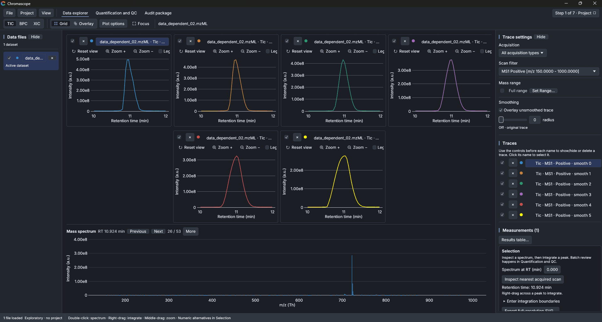
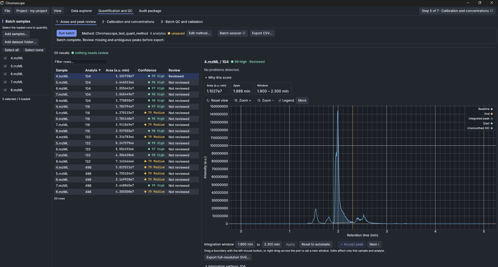

When I first wrote about Chromascope, it was a small viewer for mzML files. You opened a run, clicked on a chromatogram and looked at the spectrum under the cursor. That was useful for a quick look, but it stopped short of the work most of us actually need to finish: integrate peaks across a batch, build a calibration curve, check the QC samples and write something a colleague can verify.

The 0.3 series is my attempt to close that gap. Chromascope is now a free, lightweight, vendor-agnostic LC-MS workbench for targeted analysis. The current release is **0.3.1**, and this post walks through what changed.

:::note
- Source code, issues and releases: [github.com/chromascope-ms/chromascope](https://github.com/chromascope-ms/chromascope)
- User manual and MCP guide: [chromascope-ms.github.io/chromascope](https://chromascope-ms.github.io/chromascope/)
- Latest installers: [releases/latest](https://github.com/chromascope-ms/chromascope/releases/latest)
:::

## The data explorer, still the starting point

Everything begins with the Data explorer. You can open mzML files directly, and vendor files too once you have ProteoWizard's `msconvert` installed and linked in the app. Traces can be TIC, BPC or XIC, with an m/z tolerance in ppm or mDa. You can overlay or grid several traces, smooth them, and click on any retention time to see the mass spectrum at that scan.

## Quantification and QC

The biggest addition is the **Quantification and QC** workspace. It runs in three steps that follow the way a quantitative study is usually reviewed:

1. **Areas and peak review.** Batch integration with per-analyte settings (classic, valley/drop-line, Savitzky-Golay with SNR, or a fixed window). Every peak gets a confidence score from 0 to 100, with the named reasons behind it. Anything that needs a human look is flagged, and accepting a peak is an explicit action, so nothing is "reviewed" by accident.
2. **Calibration and concentrations.** Weighted linear and quadratic calibration, internal standards, qualifiers and dilution.
3. **Batch QC and method validation.** Rules are checked across the batch. When a rule fails, the acknowledgement needs a reason, and an acknowledgement can never turn a failing rule into a pass.

The point of the confidence score is not to replace your judgement. It tells you where to spend your attention: a batch with 20 results and "nothing needs review" is a different situation from one where 6 peaks have a medium score and an unclear baseline.

## Projects and the audit package

A quantification is only as good as your ability to explain it later. Chromascope 0.3 keeps every result in a project with append-only revisions, source hashes, and the settings that produced it. The **Audit package** tab collects the readable HTML report, along with JSON, CSV, TSV and SVG exports. You can also build a portable, checksummed bundle that someone else can verify and re-process without overwriting the original results.

## Command line and MCP servers

Not everyone wants to click through a window every time. The release ships four programs, and they all sit on the same analytical engine:

| Program | What it is |
|---|---|
| `chromascope` | The desktop app |
| `chromascope-cli` | The same engine as JSON on the command line |
| `chromascope-mcp` | The desktop app as an MCP server, so an AI assistant works in a visible window |
| `chromascope-engine-mcp` | A window-less MCP server for scripts and servers |

This release also adds support for AI agents. You can delegate data review or targeted quantitation to an agent through an MCP server, and the agent uses the same engine as the window and the command line.

When an assistant runs in `chromascope-mcp`, the status bar shows how many requests it has made, with a link to a call log. If you ask it to *propose* a change, such as new peak boundaries, the proposal appears under **Audit package → Review AI proposals** with its reason and evidence. Only your **Approve** changes a result, and the assistant cannot approve its own proposal. If you do not use AI assistants, none of this gets in your way: the desktop app works the same without them.

<video controls width="100%" src="./demo.mp4"></video>

## Installing it

Installers are on the [releases page](https://github.com/chromascope-ms/chromascope/releases/latest):

- **Windows:** `.msi` (x64, arm64, x86) or a portable `.zip`
- **macOS:** universal `.dmg` or `.zip`
- **Linux:** `.deb`, `.rpm`, `.AppImage` or `.tar.gz` (x86_64 and aarch64)

The builds are not code-signed yet, so Windows SmartScreen will ask you to choose *More info* and then *Run anyway*. On macOS, open *System Settings → Privacy & Security* and choose *Open Anyway*. Every release includes a `SHA256SUMS.txt` if you want to check your download.

The desktop app checks GitHub once a day for a newer version. You can switch that off under **View → Check for updates** or with `CHROMASCOPE_NO_UPDATE_CHECK=1`.

Feedback is welcome, whether it is a file that will not open, a result that looks off, or just general thoughts on how Chromascope fits into your work.

You can open an issue on [GitHub](https://github.com/chromascope-ms/chromascope/issues) or join the discussion on [r/massspectrometry](https://www.reddit.com/r/massspectrometry/comments/1xfaqxv/chromascope_v031_free_opensource_lcms_workbench/).

Chromascope is licensed under GPL-3.0. If it helps with work you publish, please cite the version you used. The citation details are in the repository's `CITATION.cff`, and the DOI is [10.5281/zenodo.23542311](https://doi.org/10.5281/zenodo.23542311).
